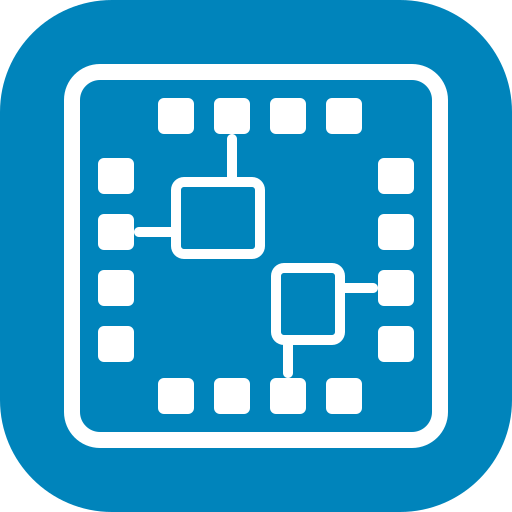
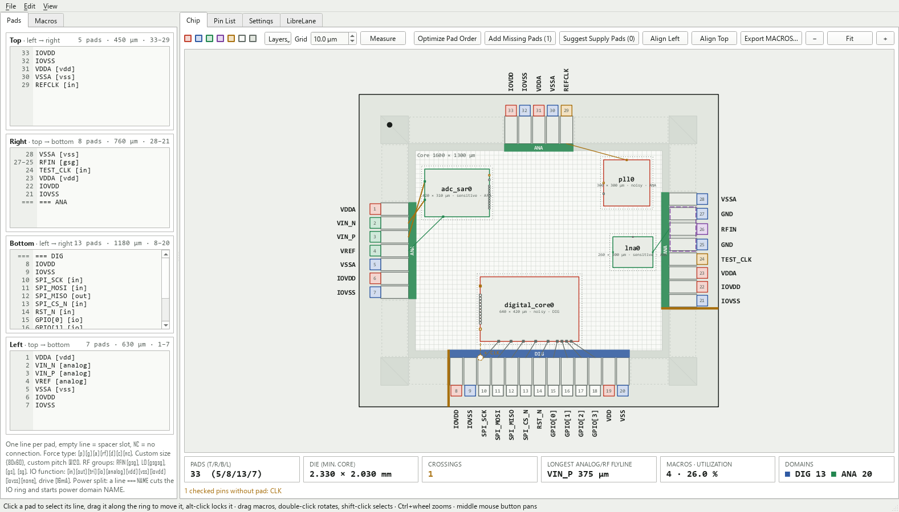
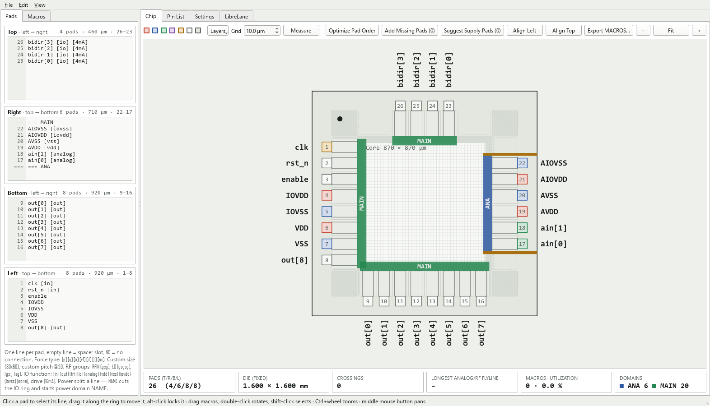
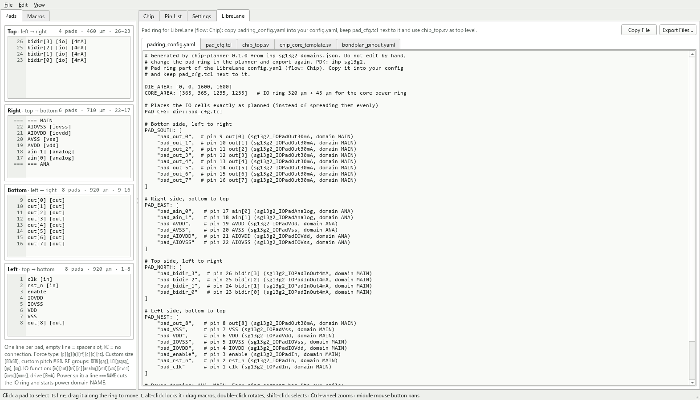

<p align="center">
  
</p>

# chip-planner: A PySide6 GUI and Python API for Planning IC Pad Rings, Pinouts and Chip Floorplans

[](https://github.com/iic-jku/chip-planner/blob/main/LICENSE)


(c) 2026 Maximilian Golser

Institute for Integrated Circuits and Quantum Computing (IICQC), Johannes Kepler University (JKU), Linz, Austria

> [!IMPORTANT]
> chip-planner (GUI, CLI and Python API) runs anywhere with **Python ≥ 3.9** and **PySide6-Essentials**, see [Install](https://github.com/iic-jku/chip-planner#install) below. The CLI export and the Python API do not load Qt at all.
> *Using* the exported files needs a **LibreLane** chip flow and the **IHP Open PDK** (SG13G2 or SG13CMOS5L). The easiest way to get both is the [IIC-OSIC-TOOLS](https://github.com/iic-jku/IIC-OSIC-TOOLS) container.


## Description

**chip-planner** plans the pad ring and the pinout of an IC before its layout starts. You type the pads of each side, one line per pad, and the die grows with them (pad-limited), so pad count, pitch and die size never disagree. It is made for analog, mixed-signal and RF designers doing early floorplanning.

It works in three layers, each optional on top of the one before:

- **Pad ring.** Plain-text side editors with tags for the pad type, IO function, drive strength, bond pad size and pitch, RF ground-signal-ground groups (`[gsg]`, and `[gsgsg]` for a differential pair), spacers, and power splits that cut the IO ring into domains.
- **PDK and package.** With IHP SG13G2 or SG13CMOS5L chosen, the ring shows the real IO cells, corner cells, bondpads and seal ring spacing, and every pad gets its IO cell. A package from the EUROPRACTICE library gives every pad its package pin. See [Supported PDKs and Packages](https://github.com/iic-jku/chip-planner#supported-pdks-and-packages).
- **Chip view.** Macros from LibreLane run directories (size and pins from their LEF) are placed in the core, with a flyline from every off-chip macro pin to its pad. Checks flag crossing flylines, split differential pairs, sensitive pads next to noisy ones, macros too close to each other and macros without a supply pad within reach. Pads and macros are dragged in the same picture, and *Optimize Pad Order*, *Add Missing Pads* and *Suggest Supply Pads* do the routine edits. See [Chip view](https://github.com/iic-jku/chip-planner#chip-view).

The plan goes straight into the chip flow: the pad ring part of the LibreLane `config.yaml`, a `pad_cfg.tcl` that places the IO cells exactly as planned, a `chip_top.sv` with the IO cell instances, the matching core template, `macros.yaml` and the bondplan `PINOUT`. A pin list (CSV) and the drawing (SVG, PNG) document it.

The code is split into a pure-Python, Qt-free model and exporters (`chip_planner.model`, `chip_planner.formats`) behind a scripting API, and a thin `chip_planner.gui` on PySide6-Essentials. The CLI exports without the GUI. How it is built and the rules it follows are in [`doc/architecture.md`](https://github.com/iic-jku/chip-planner/blob/main/doc/architecture.md).

<p align="center">
  <a href="https://raw.githubusercontent.com/iic-jku/chip-planner/main/doc/fig/chip_planner_chip_view.png"></a><br>
  <em>The chip view of <code>examples/chip_demo.json</code>: an IHP SG13G2 IO ring with the power domains ANA and DIG, four macros with their flylines, one crossing (orange) and one checked pin without a pad.</em>
</p>

<p align="center">
  <a href="https://raw.githubusercontent.com/iic-jku/chip-planner/main/doc/fig/chip_planner_io_ring.png"></a><br>
  <em>The IO ring of <code>examples/ihp_sg13g2_domains.json</code>: 26 IHP SG13G2 IO cells on a fixed 1.6 × 1.6 mm die, split into the power domains MAIN and ANA.</em>
</p>

<p align="center">
  <a href="https://raw.githubusercontent.com/iic-jku/chip-planner/main/doc/fig/chip_planner_librelane.png"></a><br>
  <em>The LibreLane tab: the pad ring part of <code>config.yaml</code>, <code>pad_cfg.tcl</code>, <code>chip_top.sv</code>, the core template and the bondplan pinout, ready to copy or export.</em>
</p>


## Directory Structure

```text
📁 chip-planner/
├─ 📁 doc/
│  ├─ 📁 fig/                    README screenshots and logos
│  └─ architecture.md            layers, conventions and the design rules of the chip view
├─ 📁 examples/
│  ├─ 📁 macros/                 abstract LEFs of four demo macros (ADC, PLL, LNA, digital core)
│  ├─ chip_demo.json             chip view demo: IHP SG13G2, two domains, four macros, an RF input
│  ├─ ihp_sg13g2_domains.json    IHP SG13G2 ring on a fixed die, two domains, QFN32 package
│  ├─ padring.json               pad ring without a PDK
│  └─ script_example.py          build, check and export a pad ring in code
├─ 📁 src/chip_planner/          the package (pip-installable)
│  ├─ 📁 data/                   PDK profiles (pdks/*.json) and the package library (packages.json)
│  ├─ 📁 formats/                project files and exports, no Qt
│  │  ├─ lef.py                  minimal LEF reader: macro size and pins
│  │  ├─ librelane.py            pad ring config, pad_cfg.tcl, chip_top.sv, macros.yaml, bondplan PINOUT
│  │  ├─ pinlist.py              pin list as CSV or tab-separated text
│  │  ├─ project_file.py         project files (JSON)
│  │  └─ svg.py                  SVG drawing of the pad ring
│  ├─ 📁 gui/                    PySide6-Essentials, uses only the model and formats API
│  │  ├─ 📁 assets/              the logo
│  │  ├─ app.py                  the GUI launcher
│  │  ├─ chip_view.py            IO ring, core, draggable macros, flylines and markers
│  │  ├─ macro_panel.py          the macro list
│  │  ├─ main_window.py          side editors, tabs, settings and LibreLane output
│  │  ├─ qt.py                   Qt binding: PySide6, PyQt6 as fallback
│  │  ├─ scene.py                draws layout primitives into a QGraphicsScene
│  │  └─ widgets.py              side editor with pin number gutter, zoomable ring view
│  ├─ 📁 model/                  pure Python, no Qt
│  │  ├─ chip.py                 pads and macros together: flylines, crossings, analog and power checks
│  │  ├─ constants.py            constants shared by the model, the exporters and the GUI
│  │  ├─ floorplan.py            hard macros placed in the core
│  │  ├─ layout.py               pin numbering, die size, geometry and drawing primitives
│  │  ├─ parse.py                editor lines to pad entries
│  │  ├─ pdk.py                  PDK and package profiles
│  │  └─ project.py              ring settings and the entry lines of each side
│  ├─ __init__.py                scripting API and version
│  ├─ __main__.py                python -m chip_planner
│  ├─ cli.py                     command line: GUI or export
│  └─ style.py                   color palettes shared by the GUI and the SVG export
├─ 📁 tests/                     unittest suite, the GUI tests run offscreen
│  ├─ 📁 data/                   layout baseline and a test macro
│  ├─ test_chip.py               chip view model: analysis and edits of pads and macros
│  ├─ test_floorplan.py          LEF reading, macro placement and pad generation
│  ├─ test_formats.py            project files, CSV, SVG, the CLI export, no Qt in the core
│  ├─ test_gui.py                GUI smoke tests
│  ├─ test_model.py              entry parser, settings, die and core sizing
│  ├─ test_pdk.py                PDK profiles, IO cells, LibreLane and bondplan exports
│  └─ test_qt_essentials.py      guards the PySide6-Essentials-only dependency
├─ LICENSE                       Apache-2.0
├─ pyproject.toml                packaging, dependency and the chip-planner entry point
├─ README.md
└─ ToDo.md                       planned work: sky130A and gf180mcuD, release
```


## How to Use

### Install

From GitHub:

```bash
pip install git+https://github.com/iic-jku/chip-planner.git
# or, for an isolated install with its own command on PATH:
pipx install git+https://github.com/iic-jku/chip-planner.git
```

From source (for development), an editable install:

```bash
git clone https://github.com/iic-jku/chip-planner.git
cd chip-planner

python -m venv .venv
# Windows:        .venv\Scripts\activate
# macOS / Linux:  source .venv/bin/activate

pip install -e .
```

The only dependency is PySide6-Essentials, which pip installs with it.

### Run the GUI

```bash
chip-planner              # after installing
chip-planner chip.json    # the same, opened on that project
```

Without a file the GUI opens the project of the last session, or the built-in example on the first start. *File → Load Example* loads that example again, and more projects live in [`examples/`](https://github.com/iic-jku/chip-planner/tree/main/examples).

From a source checkout without installing, put `src` on the Python path and start the package as a module:

```bash
PYTHONPATH=src python -m chip_planner                   # macOS / Linux
$env:PYTHONPATH = "src"; python -m chip_planner         # Windows PowerShell
```

### Typical workflow

1. **Type the pads** of each side in the *Pads* tab, one line per pad (see [Entry syntax](https://github.com/iic-jku/chip-planner#entry-syntax)). The die grows with them, and the gutter shows each pad's pin number.
2. **Choose the technology** in *Settings → Technology*: a PDK and optionally a package. The ring then shows the real IO cells, and the *Pin List* shows each pad's IO cell, power domain and package pin.
3. **Split the power domains** with `=== NAME` lines where the IO ring is cut.
4. **Add the macros** in the *Macros* tab from their LibreLane run directories, place them in the *Chip* view and check the pins that go off-chip.
5. **Fix the pinout** with *Optimize Pad Order*, *Add Missing Pads* and *Suggest Supply Pads*, until the stat tiles and the warning line are clean.
6. **Export** the LibreLane files (*File → Export LibreLane Files…*), the pin list (*File → Export Pin List as CSV…*) or the drawing (*File → Export Padframe as SVG…* or *as PNG…*), and save the project as JSON.

### Entry syntax

One line per entry. Each side lists its pads as seen on the die: top and bottom from left to right, left and right from top to bottom. Empty lines, also at the end of a side, are spacers.

| Entry | Meaning |
|---|---|
| `VDDA` | pad, type guessed from the name |
| *(empty line)* | spacer slot of one standard pitch |
| `NC` | pad without connection |
| `NAME [p\|g\|a\|rf\|d\|c\|nc]` | force type: power, ground, analog, RF, digital, clock, NC |
| `NAME {80x60}` | custom bond pad size W × H in µm (W along the edge) |
| `NAME @120` | custom pitch in µm |
| `RFIN [gsg]`, `[gs]`, `[sg]` | RF group, e.g. GND, RFIN, GND |
| `LO [gsgsg]` | differential: GND, LO_P, GND, LO_N, GND |
| `NAME [in\|out\|tri\|io\|analog\|vdd\|vss\|iovdd\|iovss\|none]` | IO function, selects the IO cell (default guessed from name and type) |
| `NAME [16mA]` | drive strength of output, tristate and bidirectional cells |
| `NAME [lock]` | locked pad: it can no longer be dragged and *Optimize Pad Order* leaves it in place |
| `=== NAME` | power split: cuts the IO ring here and starts power domain `NAME` |

Options combine: `RFOUT [gsg] {70x70} @125`, `DOUT[3] [out] [4mA]`.

### PDK, package and LibreLane

In *Settings → Technology* choose a PDK (IHP SG13G2 or SG13CMOS5L) and optionally a package from the EUROPRACTICE library.

- **With a PDK** the preview shows the real ring: the seal ring spacing, the IO cells, the corner cells and the bondpads (sizes in [Supported PDKs and Packages](https://github.com/iic-jku/chip-planner#supported-pdks-and-packages)). Function and drive of each pad are set in the *Pin List* or with tags in the editor. The rows of the *Pin List* also show the IO cell, the power domain and the package pin.
- **Power splits**: an `=== NAME` line leaves a 10 µm gap in the IO ring. Every ring segment gets its own rails (`VDD_NAME`, `VSS_NAME`, `IOVDD_NAME`, `IOVSS_NAME`), and without splits they are `VDD`, `VSS`, `IOVDD` and `IOVSS`. The planner warns when a domain has no supply pad of a kind.
- **The LibreLane tab and *File → Export LibreLane Files…*** write:
  - `padring_config.yaml`: `DIE_AREA`, `CORE_AREA`, `PAD_CFG` and the `PAD_SOUTH/EAST/NORTH/WEST` lists, to copy into the LibreLane `config.yaml` (flow `Chip`),
  - `pad_cfg.tcl`: places the IO cells exactly as planned (LibreLane's default script spreads them evenly) and keeps the split gaps free,
  - `chip_top.sv`: the IO cell instances with the same names, the top-level `*_PAD` ports and the `chip_core` instance,
  - `chip_core_template.sv`: the matching core ports, and with macros the instances to create in the core,
  - `macros.yaml` (with macros): `MACROS` with LEF and GDS and the instance locations (`i_chip_core.<instance>`),
  - `bondplan_pinout.yaml` (with a package): `PACKAGE_NAME` and `PINOUT` for the bondplan config.
- The design must still provide the bondpad cell (`PAD_BONDPAD_NAME`, e.g. `sg13g2_ip__bondpad_70x70` with `EXTRA_LEFS` and `EXTRA_GDS`), as in any IHP chip.

See [`examples/ihp_sg13g2_domains.json`](https://github.com/iic-jku/chip-planner/blob/main/examples/ihp_sg13g2_domains.json). From the command line:

```bash
chip-planner export examples/ihp_sg13g2_domains.json --librelane flow/padring
```

### Chip view

The *Chip* tab shows the whole chip: the IO ring with the pads, the core area inside it, the macros and a flyline from every checked macro pin to the pad with the same name. The left panel has two tabs, *Pads* (the side editors) and *Macros* (the macro list).

**Macros**

- *Add Macro…* (in the *Macros* tab or the *File* menu) takes a LibreLane run directory, e.g. `macros/adc_sar/`. Size and pins come from `final/lef/adc_sar_top.lef`, or from the only `*.lef` in `final/lef/`. The project stores the path, and the LEF is read again when the project opens and with *File → Reload Macros* (F5). One macro can be placed several times (`adc_sar0`, `adc_sar1`, …). *Add Placeholder…* adds a box without a LEF.
- Drag a macro to move it. It snaps to the grid (default 10 µm) and to the edges of other macros, and a dashed guide shows the edge it snapped to. Double-click or *Rotate* turns it by 90°, and *Auto-rotate* picks the rotation with the shortest flylines. Shift-click selects macros for *Align Left* and *Align Top*.
- Per macro: the pins that go off-chip, the class (`normal`, `sensitive` for analog and RF, `noisy` for digital or clocks), the power domain and the halo.

**Pads**

- Drag a pad (or a `=== NAME` split marker) along the ring to move it, also to another side, and the side editors follow. Dropped on another pad it is sorted in. Dropped on an empty part of a side (or on a spacer) it stays exactly there and no other pad moves, because empty lines fill the distance.
- Alt-click locks a pad (tag `[lock]`).
- *Add Missing Pads* adds a pad for every checked pin without one, where its dashed line points. *Suggest Supply Pads* adds VDD and VSS pads (named after the macro's LEF power pins) next to the macros that have none of their domain within reach.
- *Optimize Pad Order* sorts the connected pads of each side by the positions of their macro pins, so the flylines no longer cross. Differential pairs (`VIN_P` and `VIN_N`) stay together.

**Checks** (thresholds in *Settings → Checks*)

- Crossing flylines (orange, counted in the stat tiles) and the longest analog or RF flyline.
- Differential pairs that are not adjacent.
- A sensitive pad next to a noisy one. A connected pad takes the class of its macro, the others their type.
- Overlapping macros, macros outside the core, overlapping halos, and sensitive and noisy macros closer than the minimum distance.
- A macro without a VDD and a VSS pad of its domain within the distance. IO supplies don't count.

*Layers* hides the grid, pads, macros, halos, flylines, power domains or pad names, and *Measure* shows distances. *Edit → Undo* and *Redo* (Ctrl+Z, Ctrl+Shift+Z) cover all chip view and macro list actions. Typing in a side editor keeps its own undo while the editor has the focus.

In the *Fixed core size (minimum)* mode, which is set when the first macro is added, the die follows the core size: it is at least the core plus the IO ring (plus the PDK core margin) and still grows with the pads.

**Demo**: [`examples/chip_demo.json`](https://github.com/iic-jku/chip-planner/blob/main/examples/chip_demo.json) uses the demo macros in [`examples/macros/`](https://github.com/iic-jku/chip-planner/tree/main/examples/macros), abstract LEFs of an ADC, a PLL, an LNA and a digital core in the LibreLane run layout `final/lef/<name>_top.lef`. It starts with one crossing and one missing pad, so try *Optimize Pad Order* and *Add Missing Pads*. *Export MACROS…* shows the `macros.yaml` it exports.

### Scripting

The package works without Qt:

```python
import chip_planner as cp

project = cp.load("chip.json")
project.sides["L"].append("VDDA [p]")
project.settings.std.pitch = 90
layout = project.layout()
print(layout.die_width, layout.die_height, layout.warnings)
for pin in layout.pins:
    print(pin.no, pin.name, pin.x, pin.y)
cp.export_csv(project, "pins.csv")
cp.export_svg(project, "ring.svg")
cp.save(project, "chip.json")

macro = cp.Macro.from_dir("macros/adc_sar", "adc0")  # reads final/lef/adc_sar_top.lef
macro.io = ["VIN_P", "VIN_N"]
project.floorplan.macros.append(macro)
cp.add_missing_pads(project)                         # adds VIN_P/VIN_N pads, fixed core mode
print(cp.analyse(project).warnings)                  # crossings, pairs, analog and power checks

project.settings.pdk = "ihp-sg13g2"                  # see cp.pdk_names()
project.settings.package = "OP_QFN32_A4_FIT"         # see cp.package_names()
cp.export_librelane(project, "flow/padring")         # padring_config.yaml, pad_cfg.tcl, chip_top.sv, ...
```

`project.sides` holds each side in numbering order. `project.physical_lines(side)` and `project.set_physical_lines(side, lines)` use the order as seen on the die, like the GUI.

See [`examples/script_example.py`](https://github.com/iic-jku/chip-planner/blob/main/examples/script_example.py).

### Run the tests

```bash
python -m unittest discover -s tests -t .    # from the repo root
```

The GUI tests run offscreen and are skipped when Qt is not installed.


## CLI Overview

| Command | Does |
|---|---|
| `chip-planner` | start the GUI on the last project |
| `chip-planner chip.json` | start the GUI on `chip.json` |
| `chip-planner --version` | print the version |
| `chip-planner export chip.json --csv pins.csv` | write the pin list as CSV |
| `chip-planner export chip.json --svg ring.svg` | write the drawing as SVG |
| `chip-planner export chip.json --librelane DIR` | write the LibreLane files into `DIR` (needs a PDK in the project) |

The `export` options combine, e.g. `chip-planner export chip.json --csv pins.csv --svg ring.svg`. Each written LibreLane file is printed, and the layout warnings go to stderr. The export runs without Qt. From a source checkout without installing, use `python -m chip_planner` with `src` on the Python path in place of `chip-planner`.


## Supported PDKs and Packages

The PDK profiles are taken from the IO cell LEF and the LibreLane IO config of the [IHP Open PDK](https://github.com/IHP-GmbH/IHP-Open-PDK) (`libs.ref/<io_library>/lef/` and `libs.tech/librelane/<io_library>/config.tcl`).

| | IHP SG13G2 | IHP SG13CMOS5L |
|---|---|---|
| Profile name | `ihp-sg13g2` | `ihp-sg13cmos5l` |
| IO library | `sg13g2_io` | `sg13cmos5l_io` |
| IO cell (width × depth) | 80 × 180 µm | 80 × 180 µm |
| Corner cell | 180 × 180 µm | 180 × 180 µm |
| Bondpad | 70 × 70 µm | 70 × 70 µm |
| Seal ring spacing | 140 µm | 140 µm |
| Default pad pitch | 100 µm | 100 µm |
| Core margin (core power ring) | 45 µm | 45 µm |
| Power split gap and filler | 10 µm, `sg13g2_Filler2000` | 10 µm, `sg13cmos5l_Filler2000` |

The IO function of a pad selects its cell (`<lib>` is `sg13g2` or `sg13cmos5l`):

| Function | IO cell | Drive |
|---|---|---|
| `[in]` | `<lib>_IOPadIn` | |
| `[out]` | `<lib>_IOPadOut<drive>mA` | 4, 16 or 30 mA, default 30 mA |
| `[tri]` | `<lib>_IOPadTriOut<drive>mA` | 4, 16 or 30 mA, default 30 mA |
| `[io]` | `<lib>_IOPadInOut<drive>mA` | 4, 16 or 30 mA, default 30 mA |
| `[analog]` | `<lib>_IOPadAnalog` | |
| `[vdd]`, `[vss]` | `<lib>_IOPadVdd`, `<lib>_IOPadVss` (core supply) | |
| `[iovdd]`, `[iovss]` | `<lib>_IOPadIOVdd`, `<lib>_IOPadIOVss` (IO supply) | |
| `[none]` | no IO cell | |

The 25 packages are named after the cells of the EUROPRACTICE package library (`EP_PACKAGES_08022018.gds`). Their pins are numbered counter-clockwise, seen from the top.

| Family | Pins | Pin 1 |
|---|---|---|
| QFN | 16, 24, 32, 40, 48, 56, 64, 80, 88, 100 | top of the left side |
| JLCC | 44, 68, 84 | centre of the top side |
| CLCC | 44, 68, 84 | centre of the top side |
| SOIC | 16, 20, 24, 28 | top of the left side |
| DIL | 16, 24, 28, 40, 48 | top of the left side |

A further PDK is one more JSON file in `src/chip_planner/data/pdks/`, a further package one more entry in `src/chip_planner/data/packages.json`.


## Cite This Work

```
@misc{2026_chip_planner,
  author = {Golser, Maximilian},
  month = oct,
  year = {2026},
  title = {{GitHub Repository of chip-planner: A PySide6 GUI and Python API for Planning IC Pad Rings, Pinouts and Chip Floorplans}},
  url = {https://github.com/iic-jku/chip-planner}
}
```


## Acknowledgements

- The IO cell profiles and the LibreLane pad ring files follow the IO libraries and the LibreLane integration of the [IHP Open PDK](https://github.com/IHP-GmbH/IHP-Open-PDK).
- The exports are made for the `Chip` flow of [LibreLane](https://github.com/librelane/librelane).
- The package names and pin counts come from the [EUROPRACTICE](https://europractice-ic.com) package library.

<p align="center">
  <picture>
    <source media="(prefers-color-scheme: dark)" srcset="https://raw.githubusercontent.com/iic-jku/chip-planner/main/doc/fig/jku_white.svg">
    
  </picture>
</p>


## License

Licensed under the **Apache License 2.0**, see [`LICENSE`](https://github.com/iic-jku/chip-planner/blob/main/LICENSE).
